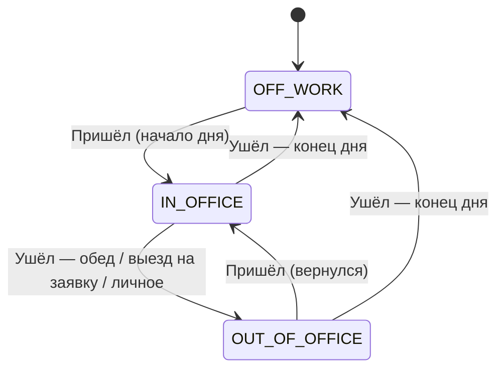

# SPEC — Офис-CRM

Техническое описание. Что и для кого делаем — в [PRD.md](PRD.md), общие правила проекта — в [CLAUDE.md](CLAUDE.md).

Время в базе хранится в UTC. Даты и проверка опозданий считаются в часовом поясе офиса `America/Los_Angeles`.

---

## 1. Данные

Модели описываются в `prisma/schema.prisma`. У каждой модели есть поля `id`, `createdAt` и `updatedAt`, ниже они не повторяются.

### User — учётная запись
| Поле | Тип | Описание |
|---|---|---|
| login | string, уникальный | логин: 3–32 символа, латиница в нижнем регистре, цифры, `.`, `-`, `_` |
| passwordHash | string | пароль хранится только в виде хэша (bcrypt, 12 раундов) |
| role | `ADMIN` / `MANAGER` / `EMPLOYEE` | роль |
| locale | `ru` / `uz` | язык интерфейса |
| employeeId | → Employee, обязательно | у каждой учётной записи есть карточка сотрудника |

### Employee — сотрудник
| Поле | Тип | Описание |
|---|---|---|
| firstName, lastName | string | имя и фамилия |
| position | string | должность |
| phone, email | string | контакты |
| deskId | → Desk, может быть пустым | рабочее место |
| status | `OFF_WORK` / `OUT_OF_OFFICE` / `IN_OFFICE` | текущий статус |
| isActive | boolean | `false` — сотрудник уволен (скрыт из списков, история остаётся) |

**Координаты на плане офиса хранятся долями (0…1) от ширины и высоты картинки.** На экране места и зоны ставятся в процентах поверх блока с теми же пропорциями, что у картинки. Поэтому при любом размере экрана они остаются на своих столах. Пиксели не хранить.

### OfficePlan — картинка плана офиса
| Поле | Тип | Описание |
|---|---|---|
| mimeType | string | `image/png`, `image/jpeg`, `image/webp`. Тестовый план из сида — `image/svg+xml` |
| data | bytes | сама картинка (хранится в БД, одна, последняя загруженная) |
| width, height | int | размер в пикселях — из заголовка файла |

Загрузка: только админ, до 5 МБ. Тип определяется по первым байтам файла, а не по имени. SVG не принимается (в нём может быть скрипт). Картинка отдаётся с заголовком `Content-Security-Policy: sandbox`.

### Desk — рабочее место на плане
| Поле | Тип | Описание |
|---|---|---|
| code | string, уникальный | номер места: `01`, `02`… |
| pcNumber | string, уникальный, может быть пустым | номер компьютера, например `PC-07` (сохраняется заглавными) |
| x, y | float 0…1 | центр места в долях картинки |

Сотрудник привязывается через `Employee.deskId` (уникальный): на месте один сотрудник, у сотрудника одно место. Если посадить сотрудника на новое место, прежнее освобождается.

### Zone — зона на плане
| Поле | Тип | Описание |
|---|---|---|
| name | string | «Кухня», «Переговорная»… |
| type | `WORK` / `MEETING` / `KITCHEN` / `OTHER` | тип (определяет цвет) |
| x, y, width, height | float 0…1 | прямоугольник в долях картинки |

### Client — клиент
| Поле | Тип | Описание |
|---|---|---|
| name | string | название компании |
| phone | string | телефон |
| address | string | адрес |
| lat, lng | float, обязательно | точка на карте (ставится кликом по карте OpenStreetMap) |
| notes | text | заметки |

### ContactPerson — контактное лицо клиента
| Поле | Тип | Описание |
|---|---|---|
| clientId | → Client | клиент |
| fullName, phone, email, role | string | контактные данные |

### Request — заявка
| Поле | Тип | Описание |
|---|---|---|
| number | int, уникальный | номер для людей: `#1024` |
| clientId | → Client | клиент |
| description | text | суть заявки |
| assigneeId | → Employee, может быть пустым | ответственный |
| status | `NEW` / `ASSIGNED` / `IN_PROGRESS` / `DONE` | новая / назначена / в работе / выполнена |
| dueDate | date, может быть пустой | срок |

Куда ехать — адрес и точка клиента.

Правила статусов заявки (`src/lib/requests.ts`):
- Назначили ответственного на новую заявку → **назначена**. Сняли ответственного → снова **новая**.
- «Назначена», «в работе», «выполнена» — только при наличии ответственного.
- Админ и менеджер ставят любой статус. Ответственный сотрудник — только «в работе» и «выполнена». Чужие заявки сотрудник не меняет.

Заявка **просрочена**, если `dueDate` раньше сегодняшней даты (по часовому поясу офиса), а статус не «выполнена».

### WorkDay — рабочий день сотрудника
| Поле | Тип | Описание |
|---|---|---|
| employeeId | → Employee | сотрудник |
| date | date | дата по LA. Пара (employeeId, date) уникальна |
| firstInAt | datetime | первый приход |
| endedAt | datetime, может быть пустым | конец дня. Пусто — день ещё идёт |
| endType | `END_OF_DAY` / `AUTO_CLOSED` | как закрыт день |
| isLate | boolean | опоздал ли |
| lateMinutes | int | на сколько минут опоздал (0, если вовремя) |
| workedMinutes | int | отработанные минуты (считаются при закрытии дня) |

### AttendanceEvent — отметка
| Поле | Тип | Описание |
|---|---|---|
| workDayId | → WorkDay | рабочий день |
| type | `IN` / `OUT` | пришёл / ушёл |
| reason | `LUNCH` / `CLIENT_VISIT` / `PERSONAL` / `END_OF_DAY`, только для `OUT` | причина ухода |
| requestId | → Request, только для `CLIENT_VISIT` | по какой заявке выезд |
| at | datetime | время отметки |
| source | `EMPLOYEE` / `ADMIN_FIX` / `SYSTEM` | кто создал отметку |

### LocationPoint — точка местоположения (все источники в одной таблице)
| Поле | Тип | Описание |
|---|---|---|
| workDayId | → WorkDay, **обязательно** | без открытого рабочего дня точку записать нельзя |
| kind | `OFFICE` / `CITY` | точка на плане офиса или на карте города |
| x, y | float 0…1, для `OFFICE` | положение на плане в долях картинки |
| lat, lng | float, для `CITY` | координаты |
| accuracy | number | точность в метрах |
| source | string | `simulator`, `phone`, позже — имя датчика |
| at | datetime | время приёма на сервере |

### AuditLog — журнал изменений
| Поле | Тип | Описание |
|---|---|---|
| actorUserId | → User | кто изменил |
| entity, entityId | string | что изменили (`AttendanceEvent`, `Request`…) |
| action | `CREATE` / `UPDATE` / `DELETE` | действие |
| before, after | JSON | значения до и после |
| reason | string | причина. **Обязательна** при исправлении отметок |

---

## 2. Страницы

У всех страниц есть префикс языка: `/ru/...` или `/uz/...`. Без входа открывается только страница входа.

| Путь | Кто видит | Что на странице |
|---|---|---|
| `/login` | все | вход по логину и паролю |
| `/check-in` | сотрудник, менеджер | **обязательная отметка прихода**: кнопка «Я пришёл» и своё рабочее место на плане. Пока нет отметки за сегодня, любая страница перенаправляет сюда (проверка в `requireUser`, данные страниц не загружаются), меню скрыто |
| `/` | все | **Главная**: «Мой день» — время прихода, «вовремя» или «опоздание N мин», кнопка «Закончить работу» (с подтверждением), после неё — время ухода и отработанное время. Админ отмечается здесь же, без блокировки. **У админа — панель** (обновляется сама каждые 3 с через `GET /api/admin/dashboard`): плитки «В офисе», «Вне офиса», «Не пришли», «Опоздали», «Заявок в работе»; **мини-карта офиса** — загруженный план и цветные точки только тех, кто в офисе (у каждого свой постоянный цвет), при наведении — имя, место или зона, время последней отметки; **лента последних событий** — приход, выход (причина), возвращение, конец дня, заявка назначена (кем, в т. ч. «ИИ-агент»). Ниже — «Мой день», «Не отметились после 09:05» и «Опоздали сегодня» |
| `/employees` | все | список сотрудников со статусом и поиском |
| `/employees/[id]` | все; история отметок — только сам сотрудник и админ | карточка сотрудника |
| `/employees/new` | админ | добавить сотрудника или менеджера: имя, фамилия, должность, логин, роль, рабочее место, пароль |
| `/employees/[id]/edit` | админ | изменить те же поля; пустой пароль — не менять. Учётки администраторов здесь не меняются |
| `/clients` | все | карта со всеми клиентами и универсальная таблица (поиск, сортировка, раскрытие строки — заявки клиента); клик по строке — выезжающая карточка клиента с правкой полей «на лету» и историей |
| `/clients/new` | админ, менеджер | новый клиент: название, телефон, адрес, точка кликом по карте |
| `/clients/[id]` | все | карточка клиента, точка на карте, его заявки |
| `/requests` | все | заявки; фильтр по статусу `?status=NEW`, «только мои» `?mine=1`, вид `?view=board`. **Таблица**: поиск, сортировка, раскрытие строки, мультивыбор с панелью массовых действий (назначить, сменить статус — админ и менеджер). **Доска (канбан)**: колонки по статусам, перетаскивание мышью и с клавиатуры, запрещённые переходы отклоняются с объяснением. Клик по заявке — выезжающая карточка: поля «на лету» (статус, ответственный, срок, описание) и история изменений |
| `/requests/new` | админ, менеджер | новая заявка: клиент, описание, ответственный, срок (`?client=` подставляет клиента) |
| `/requests/[id]` | все; назначает админ и менеджер, статус — см. правила выше | карточка заявки, назначение ответственного, смена статуса, точка клиента на карте |
| `/office` | все | **план офиса**: картинка, зоны, места с номером и цветом статуса сотрудника, таблица мест |
| `/office/edit` | админ | редактор: загрузить картинку, кликом ставить места (номер места, номер ПК, сотрудник), протягиванием рисовать зоны, клик по месту или зоне — изменить или удалить, кнопка «Тестовый план» |
| `/map` | **только админ** | **«На карте города»** — настоящая карта OpenStreetMap (обновление каждые 3 с через `GET /api/admin/city`): офис (`OFFICE_LOCATION` в `.env`), открытые заявки — по точке на клиента со списком заявок, сотрудники «вне офиса» цветом по причине. Нажатие на сотрудника — имя, причина выхода и во сколько вышел. Вернувшийся в офис пропадает отсюда и появляется на плане офиса. Ниже — таблица вне офиса |
| `/attendance` | админ | отметки всех за день и **исправление** отметок (с причиной) — *ещё не сделано* |
| `/reports` | админ, менеджер | выбор дат «с» и «по», кнопка «Скачать Excel» |
| `/timeline` | админ, менеджер | **«Время»** — диаграмма Ганта: строки — сотрудники, полосы — в офисе / обед / выезд / личное; масштаб День ↔ Неделя ↔ Месяц с плавным переходом; линия «сейчас» |
| `/audit` | админ | журнал изменений |


**Оформление** — дизайн-система «Strict Dark» (CLAUDE.md, раздел «Дизайн-система»): каркас со сворачиваемым сайдбаром, меню команд Ctrl+K (разделы, отметки, поиск по `GET /api/search?q=`), уведомления-тосты, переходы страниц и скелетоны загрузки. Данные выезжающих карточек — `GET /api/entities/request/[id]`, `GET /api/entities/client/[id]`; правка — серверные действия `updateRequestField`, `updateClientField`, `bulkUpdateRequests` (`src/app/[locale]/(app)/entity-actions.ts`), каждое изменение пишется в AuditLog. Диаграмма — `GET /api/timeline?view=&date=`.

Цвета статусов: в офисе — приглушённый изумруд, вне офиса — бронза, не на работе — серый.

---

## 3. Статусы



| Действие | Из статуса | В статус | Что ещё происходит |
|---|---|---|---|
| Пришёл | `OFF_WORK` | `IN_OFFICE` | создаётся WorkDay, проверяется опоздание |
| Пришёл | `OUT_OF_OFFICE` | `IN_OFFICE` | запись координат останавливается |
| Ушёл: обед / выезд / личное | `IN_OFFICE` | `OUT_OF_OFFICE` | начинается запись координат. Для выезда нужно выбрать заявку |
| Ушёл: конец дня | `IN_OFFICE` или `OUT_OF_OFFICE` | `OFF_WORK` | WorkDay закрывается, считаются часы, запись координат останавливается |

Правила:
- **Запрещённые переходы** (например, «Пришёл» в статусе `IN_OFFICE`) сервер отклоняет с ошибкой. Кнопки, которые сейчас нельзя нажать, в интерфейсе скрыты.
- Уйти «вне офиса» можно и прямо со статуса `OUT_OF_OFFICE`, например с обеда сразу на выезд: причина меняется, статус остаётся тем же.
- **Новый рабочий день** начинается только с «Пришёл» после «Конца дня». В одну дату — один WorkDay. Если день уже закрыт, повторный «Пришёл» в ту же дату отклоняется: вернуть сотрудника может только админ.
- **Сделано сейчас:** «Я пришёл» и «Закончить работу» (`src/lib/attendance/service.ts`, API `GET/POST /api/attendance` с `{action: "in" | "end"}`). Время берётся на сервере. Повторный «Я пришёл» в тот же день отклоняется (`409`). Обед, выезд и «личное» пока не сделаны.
- **Забыл нажать «Конец дня»:** сейчас незакрытый день закрывается при следующем «Я пришёл» (`AUTO_CLOSED`, время ухода — последняя отметка). Позже: в 23:59 по LA задача (cron) закрывает день с `endType = AUTO_CLOSED`. Время ухода — время последней отметки. Статус становится `OFF_WORK`, запись координат останавливается. В отчёте такой день помечен «уход не отмечен».
- **Исправления делает только админ** на странице `/attendance`. Указать причину обязательно, иначе изменение не сохранится. Отметка получает `source = ADMIN_FIX`, в AuditLog пишется, что было и что стало. После исправления опоздание и часы пересчитываются.
- Вся логика переходов собрана в одной чистой функции в `src/lib/attendance/` и покрыта тестами.

---

## 4. Опоздания и отработанное время

Рабочий день начинается в **09:00**, на опоздание есть **5 минут**.

- Приход до **09:05:59** включительно — вовремя.
- С **09:06:00** — опоздание. `lateMinutes` = целые минуты, прошедшие с 09:00.
- Считается **только первый приход** за день. Возвращения с обеда и выездов на опоздание не влияют.
- Время — по LA (`OFFICE_TIMEZONE`). Переход на летнее и зимнее время учитывает библиотека date-fns-tz.

| Первый приход | Опоздание? | lateMinutes |
|---|---|---|
| 08:50 | нет | 0 |
| 09:05 | нет | 0 |
| 09:05:59 | нет | 0 |
| 09:06 | **да** | 6 |
| 10:30 | **да** | 90 |

**Отработанное время** = от первого прихода до конца дня **минус** время вне офиса по причинам «обед» и «личное». **Выезд на заявку считается рабочим временем.**

Пример: пришёл в 09:00, обед 13:00–14:00, выезд 15:00–16:30, конец дня в 18:00 → 9 ч − 1 ч обеда = **8 ч**.

---

## 5. Местоположение

- Записывается **только при открытом сегодняшнем WorkDay**: от «Я пришёл» до «Закончить работу».
- **Одно общее место для всех позиций:** `POST /api/positions` (`src/lib/positions.ts`).
  - Устройства (имитация, будущие датчики в офисе): заголовок `Authorization: Bearer <POSITIONS_API_KEY>`, любые сотрудники.
  - Телефон: обычный вход на сайт, только свои точки `CITY`.
  - Тело: `{ source, positions: [{ employeeId, kind: "OFFICE", x, y } | { employeeId, kind: "CITY", lat, lng, accuracy? }] }`, до 500 точек.
  - Ответ: `{ accepted, rejected }`.
- **Проверка на сервере:** `OFFICE` принимается только у тех, кто `IN_OFFICE`; `CITY` — только у `OUT_OF_OFFICE`; без открытого дня — отклоняется. Время точки — серверное.
- `GET /api/positions/live` — кто где сейчас. Вошедшие видят план офиса; точки в городе, причины и заявки — только админ; устройство с ключом получает ещё зоны плана и центр города (`CITY_CENTER`).
- **Телефон:** пока сотрудник «вне офиса», открытая страница сайта отправляет координаты не чаще раза в минуту (геолокация браузера — только на localhost или по HTTPS). Если доступ запрещён — «Местоположение неизвестно», без ошибок.
- **Имитация** (`scripts/simulator.ts`, `npm run sim:on` / `sim:off` / `sim:status`): каждые 3 с берёт `/api/positions/live`, двигает людей и шлёт всё в `POST /api/positions` с `source: "simulator"`. «В офисе» — со своего места на кухню или в переговорную, побыть там 3–8 шагов, обратно. «Вне офиса» — на выезде едут к клиенту своей заявки, на обеде и по личным делам гуляют по случайному маршруту вокруг `CITY_CENTER`.
- `npm run demo:today` — отметить приход всем и отправить троих из офиса (выезд, обед, личное), чтобы имитации было кого двигать в любое время.
- Карту видит только админ. Сотрудники и ИИ-агент координаты города не получают.

---

## 6. Отчёт в Excel

Генерируется библиотекой ExcelJS на сервере (`src/lib/reports/attendance.ts`): `GET /api/reports/attendance?from=2026-10-01&to=2026-10-31&locale=ru`. Скачивают админ и менеджер. Период — не больше 366 дней.

**Имя файла:** `office-report_2026-10-01_2026-10-31.xlsx`
**Язык заголовков и названий листов** — язык того, кто скачивает (`messages/*.json`, раздел `reports`).
Сверху — название и период, строка заголовков закреплена, у колонок автофильтр.

**Как считаются часы:** «вне офиса» — от каждого «Вышел» (обед, выезд, личное) до следующего «Вернулся» или до ухода; «в офисе» — всё остальное время от прихода до ухода. Незакрытый сегодняшний день считается до текущего момента. Часы записаны как длительность Excel (их можно складывать), формат — `[h] "ч" mm "мин"`.

### Лист «Сводка» — одна строка на сотрудника
| Сотрудник | Дней на работе | Опозданий | Часов в офисе | Часов вне офиса |
|---|---|---|---|---|
| Фамилия Имя | число | число | N ч MM мин | N ч MM мин |

### Лист «По дням» — одна строка на сотрудника за день
| Дата | Сотрудник | Приход | Уход | Опоздание, мин | Часов в офисе | Часов вне офиса |
|---|---|---|---|---|---|---|
| 2026-10-23 | Тестова Алиса | 09:12 | 18:00 | 12 | 7 ч 48 мин | 1 ч 00 мин |

Это пример из задания (приход 09:12, обед 13:00–14:00, уход 18:00) — он есть в демо и проверяется тестом `src/lib/reports/attendance.test.ts`. Строки с опозданием подсвечены светло-красным. Незакрытый день — «не закрыт» в колонке «Уход».

Время — по часовому поясу офиса. Координат в отчёте нет.

---

## 7. ИИ-агент: MCP-сервер и API

```
Агент (Claude Code) ──Bearer MCP_SECRET_KEY──▶ MCP-сервер (mcp-server/, :3100/mcp) ──Bearer AGENT_API_KEY──▶ сайт /api/agent/*
```

- **MCP-сервер** — папка `mcp-server/`, свой `package.json`. Запуск: `npm run mcp` (или `cd mcp-server && npm start`). Транспорт Streamable HTTP без сессий, адрес `http://localhost:3100/mcp`.
- **Без ключа никого не пускает:** заголовок `Authorization: Bearer <MCP_SECRET_KEY>` (из `mcp-server/.env`, не короче 24 символов), иначе `401`. Без заданного ключа сервер не запускается.
- Сам MCP-сервер ничего не решает: вызывает сайт с ключом `AGENT_API_KEY` и превращает ответы и коды ошибок в понятный русский текст. Правила (кто свободен, приватность, расчёт часов) — на сайте, `src/lib/agent.ts`.
- **Подключение к агенту:** `.mcp.json` в корне проекта, ключ берётся из переменной окружения `OFFICE_MCP_KEY` (в файле ключа нет).
- Агент **не получает** координаты, пароли и email учётных записей: «где» описывается словами (место, зона плана, причина выхода, заявка).
- Проверка: `npm run mcp:check` (сайт и MCP-сервер запущены) — ключ, все инструменты и сообщения об ошибках; данные не меняет.

| Инструмент MCP | Что делает | API сайта |
|---|---|---|
| `where_is_everyone` | где сейчас все сотрудники и статус: на своём месте / в зоне («Кухня», «Переговорная») / вне офиса (причина, с какого времени, заявка) / закончил день / нет отметки | `GET /api/agent/status` |
| `find_employee` `{name}` | поиск по имени или фамилии (часть, без учёта регистра): должность, статус, место и ПК, телефон, активные заявки | `GET /api/agent/search?q=` |
| `late_today` `{date?}` | кто опоздал и на сколько минут; за сегодня после 09:05 — ещё кто не отметился | `GET /api/agent/late?date=` |
| `attendance_summary` `{from, to}` | сводка прихода и ухода за период до 62 дней: по сотрудникам и по дням (те же цифры, что в Excel) | `GET /api/agent/attendance?from=&to=` |
| `assign_request_to_free_employee` `{request_number, employee_name?, reassign?}` | назначить заявку свободному сотруднику в офисе: роль «сотрудник», статус «в офисе», нет заявок «в работе»; из таких — у кого меньше назначенных. Пишется в журнал с `actorLabel: "ai-agent"` | `POST /api/agent/assign` |

Ошибки сайта приходят кодом (`requestNotFound`, `alreadyAssigned`, `noFreeEmployee`, `employeeNotFree`, `periodTooLong`, …), MCP-сервер отвечает понятным сообщением с подсказкой, что сделать (`mcp-server/src/app-client.ts`). Если сайт не запущен — «Сайт Офис-CRM не отвечает… Запустите npm run dev».

### Возможные следующие вопросы агента (ещё не сделаны)

| Вопрос агента | Запрос |
|---|---|
| Кто сейчас в офисе, вне офиса, не на работе? | `GET /api/agent/status` |
| Кто сейчас на выезде и по какой заявке? | `GET /api/agent/status?status=OUT_OF_OFFICE` — у каждого причина и номер заявки |
| Кто опоздал сегодня? | `GET /api/agent/late?date=today` |
| Кто опаздывал за период и сколько раз? | `GET /api/agent/late?from=…&to=…` |
| Сколько часов отработал сотрудник X за неделю или месяц? | `GET /api/agent/hours?employee=…&from=…&to=…` |
| Кто не отметил уход? | `GET /api/agent/workdays?endType=AUTO_CLOSED&from=…&to=…` |
| Какие заявки открыты и у кого они? | `GET /api/agent/requests?status=NEW,IN_PROGRESS` |
| Какие заявки просрочены? | `GET /api/agent/requests?overdue=true` |
| Какие заявки у клиента Y? | `GET /api/agent/requests?client=…` |
| Где сидит сотрудник X? | `GET /api/agent/employees/[id]` — номер места и зона |
| Какие рабочие места свободны? | `GET /api/agent/desks?free=true` |
| Найти сотрудника или клиента по имени | `GET /api/agent/search?q=…` |

---

## 8. Роли и безопасность

| Действие | Сотрудник | Менеджер | Админ | ИИ-агент |
|---|---|---|---|---|
| Отметить свой приход и уход | ✅ | ✅ | ✅ | ❌ |
| Смотреть список сотрудников и план офиса | ✅ | ✅ | ✅ | ✅ (без координат) |
| Видеть логины сотрудников | ❌ | ❌ | ✅ | ❌ |
| Смотреть карту города | ❌ | ❌ | ✅ | ❌ |
| Исправлять отметки | ❌ | ❌ | ✅ (с причиной) | ❌ |
| Добавлять и менять сотрудников и менеджеров | ❌ | ❌ | ✅ | ❌ |
| Менять места на плане | ❌ | ❌ | ✅ | ❌ |
| Вести клиентов | ❌ | ✅ | ✅ | ❌ |
| Создавать заявки и назначать исполнителя | ❌ | ✅ | ✅ | только назначать свободному сотруднику в офисе (MCP) |
| Менять статус своей заявки | ✅ | ✅ | ✅ | ❌ |
| Скачивать Excel | ❌ | ✅ | ✅ | ❌ |
| Смотреть журнал изменений | ❌ | ❌ | ✅ | ❌ |

Менеджер — руководитель проектов или аккаунт-менеджер: работает с клиентами и заявками, но не управляет людьми и не видит местоположение.

- Права проверяются **на сервере** в каждом API-запросе. Скрытая кнопка в интерфейсе защитой не считается.
- Пароли, `AUTH_SECRET` и `AGENT_API_KEY` хранятся только в `.env`. Файл не попадает в Git.
- Все демо-данные вымышленные: email на `@example.com`, телефоны сотрудников `+1 555-01xx`, клиентов — `+998 00 000-00-0x` (кода оператора «00» не существует).
- Демо: тестовый план 1000×640 (опенспейс, переговорная, кухня), 13 мест `01`–`13` с компьютерами `PC-01`–`PC-13`, у каждого из 13 человек своё место; 5 клиентов в Ташкенте с вымышленными улицами; 10 заявок во всех статусах, две просрочены.
- Демо-учётки: `admin`, `manager1`, `manager2`, `employee1` … `employee10`. Пароль у каждой роли свой, хранится в `.env` (`DEMO_ADMIN_PASSWORD`, `DEMO_MANAGER_PASSWORD`, `DEMO_EMPLOYEE_PASSWORD`).
- Каждое добавление и изменение сотрудника пишется в AuditLog, хэш пароля туда не попадает.
